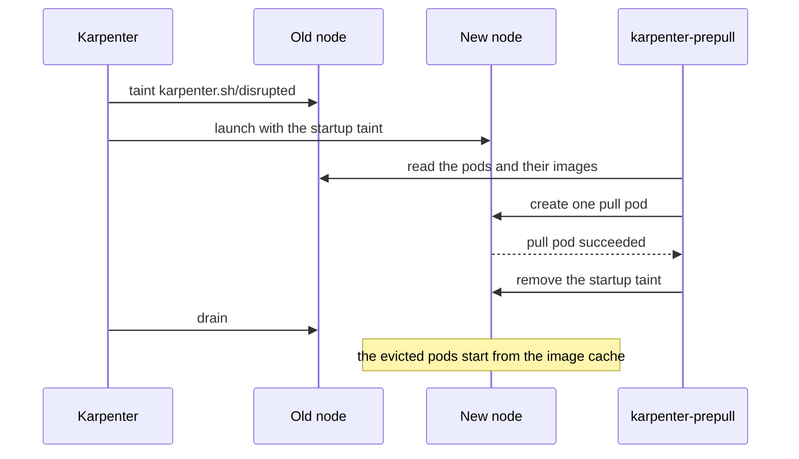

# karpenter-prepull

`karpenter-prepull` pulls container images onto a Karpenter replacement node before Karpenter drains the old node.

When Karpenter replaces a node, the evicted pods start on a node with an empty image cache. Each pod then waits for
its images. For a workload that runs one replica, that wait is downtime. `karpenter-prepull` moves the pull ahead of
the eviction, so the pods find their images on the new node.

## How it works

For drift and consolidation, Karpenter replaces a node in a fixed order:

1. It puts the `karpenter.sh/disrupted` taint on the old node.
2. It starts the replacement node and waits until the node is initialized.
3. It drains the old node.

A node is not initialized while it carries one of its [startup taints][startup-taints]. `karpenter-prepull` uses that
as a gate:



The pull pod is an ordinary pod that is bound to the new node. It has one container per predicted image. Each
container runs a small static binary from a shared volume and exits. So the kubelet pulls every image with the
credentials the node already has, and the pod succeeds when all pulls are done.

The controller needs no access to the container runtime and runs no agent on the nodes.

### Which images it pulls

The controller looks at every node that carries the `karpenter.sh/disrupted` taint. It takes the pods on those nodes
that could run on the new node: the node selector and the required node affinity match, and the pod tolerates the
taints of the new node. It skips DaemonSet pods, static pods and finished pods. It pulls the images of the remaining
pods that the new node does not hold, most used first. It leaves out an image that a pod on a disrupted node
already fails to pull, because that pull would hold the node until the timeout.

A node that starts while no node is disrupted is released at once. A scale-up node is not delayed.

### It fails open

A node never keeps the startup taint for more than `timeout` (default `2m`) after it registers, as long as the
controller runs. When the time is up, the controller removes the taint and Karpenter continues. The pods then pull
what is missing, as they do without this controller.

The controller releases the node at once when the pull pod fails, or when the API server rejects the pull pod, for
example because of an admission policy.

## Install

```sh
helm install karpenter-prepull oci://ghcr.io/goldsky-io/charts/karpenter-prepull \
  --namespace karpenter-prepull --create-namespace
```

Then add the startup taint to each NodePool that you want to gate:

```yaml
apiVersion: karpenter.sh/v1
kind: NodePool
spec:
  template:
    spec:
      startupTaints:
        - key: karpenter-prepull.goldsky.com/pending
          effect: NoSchedule
```

Install the controller before you add the taint. See [Operate it](#operate-it).

> [!WARNING]
> A change to `startupTaints` changes the NodePool template. Karpenter treats the existing nodes of that NodePool as
> drifted and replaces them. Add a `Drifted` budget of `nodes: "0"` first if you want to control when that happens.

## Configure

| Chart value | Default | Meaning |
| -- | -- | -- |
| `startupTaintKey` | `karpenter-prepull.goldsky.com/pending` | Taint that gates a node. |
| `timeout` | `2m` | Longest time a node keeps the startup taint after it registers. |
| `maxImages` | `30` | Most images one pull pod pulls. |
| `ignoreTaintKeys` | `[]` | Startup taints of other components. See below. |
| `pullPod.hostNetwork` | `false` | Run pull pods on the host network. |
| `pullPod.priorityClassName` | `""` | Priority class of the pull pods. |
| `replicas` | `2` | Controller replicas. One is active. |

**Other startup taints.** If a NodePool has startup taints of other components (a CNI or CSI agent, for example),
list their keys in `ignoreTaintKeys`. The new node still carries those taints when the controller looks at it. Without
the setting, the controller decides that the pods cannot run there and pulls nothing. Taints under
`node.kubernetes.io/`, `node.cloudprovider.kubernetes.io/` and `karpenter.sh/` are always ignored.

**Host network.** By default a pull pod waits for the CNI to assign it a pod IP, which can take a while on a node
that is still starting. Set `pullPod.hostNetwork` to `true` to skip that wait. The `baseline` Pod Security Standard
forbids host network pods, so check the policy of the namespace first. The containers of the pull pod run only the
no-op binary, as a non-root user, with no capabilities and a read-only root file system.

## Operate it

**While the controller is down, gated nodes stay gated.** Karpenter does not remove a startup taint and does not
replace a node that keeps one. If no replica of the controller runs, new nodes of the gated NodePools accept no pods.
Run two replicas (the default) and alert on this condition. For example, alert when a node has carried the startup
taint for more than five minutes:

```promql
max by (node) (kube_node_spec_taint{key="karpenter-prepull.goldsky.com/pending"}) == 1
```

To release a node by hand:

```sh
kubectl taint node <node> karpenter-prepull.goldsky.com/pending-
```

**Metrics.** The controller serves Prometheus metrics on port `8080`.

| Metric | Meaning |
| -- | -- |
| `karpenter_prepull_releases_total{result}` | Nodes released. `result` is `pulled`, `nothing_to_pull`, `timeout` or `failed`. |
| `karpenter_prepull_pull_duration_seconds{result}` | Time from the creation of the pull pod to the release. |
| `karpenter_prepull_images_requested_total` | Images that pull pods were asked to pull. |

**Events.** The controller records `PrepullStarted` and `PrepullReleased` events on the node.

## Limits

- **Forceful disruption is not covered.** Spot interruption and node expiry drain the old node at once. Karpenter
  does not wait for a replacement, so there is nothing to gate.
- **Only the new node is warmed.** The scheduler places the evicted pods. A pod that lands on another existing node
  pulls its images there. This includes the case where Karpenter starts no replacement because the pods fit on
  existing nodes.
- **The prediction is a superset.** The controller does not know which disrupted node a new node replaces. It pulls
  for all disrupted nodes whose pods fit the new node.
- **Pods with `imagePullSecrets` are skipped.** The pull pod cannot read a secret of another namespace. Images that
  the node can pull with its own credentials work, for example through a kubelet credential provider.
- **`imagePullPolicy: Always` still contacts the registry.** The layers are cached, so the pull is short. If a
  mutable tag moves between the pre-pull and the start of the pod, the pod pulls the new image.
- **Linux nodes only.**

## Permissions

| Scope | Resource | Verbs | Why |
| -- | -- | -- | -- |
| Cluster | `nodes` | get, list, watch, patch | Find gated and disrupted nodes. Remove the startup taint. |
| Cluster | `pods` | get, list, watch | Read the pods on disrupted nodes. |
| Cluster | `events.events.k8s.io` | create, patch | Record events on nodes. |
| Own namespace | `pods` | create, delete | Manage pull pods. |
| Own namespace | `leases`, `events` | all, create | Leader election. |

## Develop

```sh
go test ./...
helm lint charts/karpenter-prepull
docker build .
```

## License

Apache-2.0. See [LICENSE](LICENSE).

[startup-taints]: https://karpenter.sh/docs/concepts/nodepools/#spectemplatespecstartuptaints
