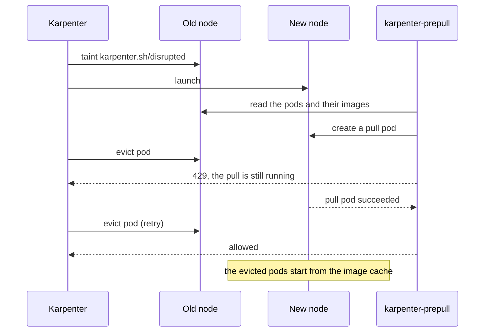

# karpenter-prepull

`karpenter-prepull` pulls container images onto a Karpenter replacement node before Karpenter evicts the pods of the
old node.

When Karpenter replaces a node, the evicted pods start on a node with an empty image cache. Each pod then waits for
its images. For a workload that runs one replica, that wait is downtime. `karpenter-prepull` moves the pull ahead of
the eviction, so the pods find their images on the new node.

It needs no change to your NodePools, no agent on the nodes and no access to the container runtime. If it is down,
Karpenter behaves as it does without it.

## How it works

For drift and consolidation, Karpenter replaces a node in a fixed order:

1. It puts the `karpenter.sh/disrupted` taint on the old node.
2. It starts the replacement node and waits until the node is ready.
3. It drains the old node: it evicts the pods through the Eviction API.

`karpenter-prepull` has two parts that use this order:

- A **controller** starts a pull pod on each new node while step 2 runs.
- A **webhook** on the Eviction API holds step 3 until the pull pods are done.



The pull pod is an ordinary pod that is bound to the new node. It has one container per image. Each container runs a
small static binary from a shared volume and exits. So the kubelet pulls every image with the credentials the node
already has, and the pod finishes when all pulls are done.

The webhook answers a held eviction with HTTP 429, which is also the answer for an eviction that a
PodDisruptionBudget blocks. Karpenter and `kubectl drain` both retry it.

### Which nodes it warms

The controller acts on a node when both are true:

- The node carries the `karpenter.sh/disrupted` taint.
- Its NodeClaim has the `DisruptionReason` condition. Karpenter sets it for drift and consolidation, where it starts
  the replacement first.

It then warms every node that is younger than `targetNodeMaxAge` (default `15m`) and is not itself disrupted,
cordoned or being deleted. A replacement node is always in that set. Set `targetNodeMaxAge` to `0` to warm every node
that the pods fit.

### Which images it pulls

The controller takes the pods on the old node that could run on the new node: the node selector and the required
node affinity match, and the pod tolerates the taints of the new node. It skips DaemonSet pods, static pods and
finished pods. It pulls the images of the remaining pods that the new node does not hold, most used first. It leaves
out an image that a pod already fails to pull.

### It fails open

The webhook holds an eviction only while a pull pod for that pod's images is running. In every other case the
eviction passes:

- No pull pod exists, for example because the controller is down or an admission policy rejected the pull pod.
- The pull pod finished or failed.
- More than `timeout` (default `2m`) passed since the drain started.
- The pod is not part of a Karpenter drift or consolidation.

The webhook is registered with `failurePolicy: Ignore` and a 2-second timeout. If no replica answers, the API server
lets the eviction pass. So an outage of `karpenter-prepull` costs the warm-up and nothing else.

## Install

```sh
helm install karpenter-prepull oci://ghcr.io/goldsky-io/charts/karpenter-prepull \
  --namespace karpenter-prepull --create-namespace
```

That is all. The chart creates the webhook and a self-signed certificate for it.

## Configure

| Chart value | Default | Meaning |
| -- | -- | -- |
| `timeout` | `2m` | Longest time evictions are held after a drain starts. Also the deadline of a pull pod. |
| `targetNodeMaxAge` | `15m` | Warm only nodes younger than this. `0` warms every node the pods fit. |
| `maxImages` | `30` | Most images one pull pod pulls. |
| `ignoreTaintKeys` | `[]` | Startup taints of other components. See below. |
| `webhook.timeoutSeconds` | `2` | Seconds the API server waits for the webhook. |
| `pullPod.hostNetwork` | `false` | Run pull pods on the host network. |
| `pullPod.priorityClassName` | `""` | Priority class of the pull pods. |
| `replicas` | `2` | Replicas. One starts pull pods. All serve the webhook. |

**Startup taints of other components.** If a NodePool has startup taints (a CNI or CSI agent, for example), list
their keys in `ignoreTaintKeys`. A new node still carries those taints when the controller looks at it. Without the
setting, the controller decides that the pods cannot run there and pulls nothing. Taints under
`node.kubernetes.io/`, `node.cloudprovider.kubernetes.io/` and `karpenter.sh/` are always ignored.

**Host network.** By default a pull pod waits for the CNI to assign it a pod IP, which can take a while on a node
that is still starting. Set `pullPod.hostNetwork` to `true` to skip that wait. The `baseline` Pod Security Standard
forbids host network pods, so check the policy of the namespace first. The containers of the pull pod run only the
no-op binary, as a non-root user, with no capabilities and a read-only root file system.

## Operate it

**Metrics.** Each replica serves Prometheus metrics on port `8080`.

| Metric | Meaning |
| -- | -- |
| `karpenter_prepull_pull_pods_created_total` | Pull pods created. |
| `karpenter_prepull_images_requested_total` | Images that pull pods were asked to pull. |
| `karpenter_prepull_evictions_total{decision}` | Evictions from nodes that Karpenter drains by choice. `decision` is `allowed`, `held` or `timeout`. |

A rising `timeout` count means pulls are slower than `timeout`. The evictions pass anyway.

**Events.** The controller records `PrepullStarted` and `PrepullFailed` events on the old node. While an eviction is
held, Karpenter reports `FailedDraining` on the node with a PodDisruptionBudget message. That is how Karpenter words
every 429 answer.

**Roll time.** A held drain makes each node replacement longer by about the time of the pulls.

## Limits

- **Forceful disruption is not covered.** Spot interruption and node expiry drain the old node at once. Karpenter
  starts no replacement first, so there is no node to warm.
- **Only new nodes are warmed by default.** The scheduler places the evicted pods. A pod that lands on an older node
  pulls its images there. `targetNodeMaxAge: 0` removes this limit at the cost of more pulls.
- **Pods with `imagePullSecrets` are skipped.** The pull pod cannot read a secret of another namespace. Images that
  the node can pull with its own credentials work, for example through a kubelet credential provider.
- **`imagePullPolicy: Always` still contacts the registry.** The layers are cached, so the pull is short. If a
  mutable tag moves between the pre-pull and the start of the pod, the pod pulls the new image.
- **Linux nodes only.**

## Permissions

| Scope | Resource | Verbs | Why |
| -- | -- | -- | -- |
| Cluster | `nodes` | get, list, watch | Find draining nodes and new nodes. |
| Cluster | `nodeclaims.karpenter.sh` | get, list, watch | Read why Karpenter disrupts a node. |
| Cluster | `pods` | get, list, watch | Read the pods on draining nodes. |
| Cluster | `events.events.k8s.io` | create, patch | Record events on nodes. |
| Own namespace | `pods` | create, delete | Manage pull pods. |
| Own namespace | `leases`, `events` | all, create | Leader election. |

The controller changes no node and no workload. Its only writes outside its namespace are events.

## Develop

```sh
go test ./...
helm lint charts/karpenter-prepull
docker build .
```

## License

Apache-2.0. See [LICENSE](LICENSE).
